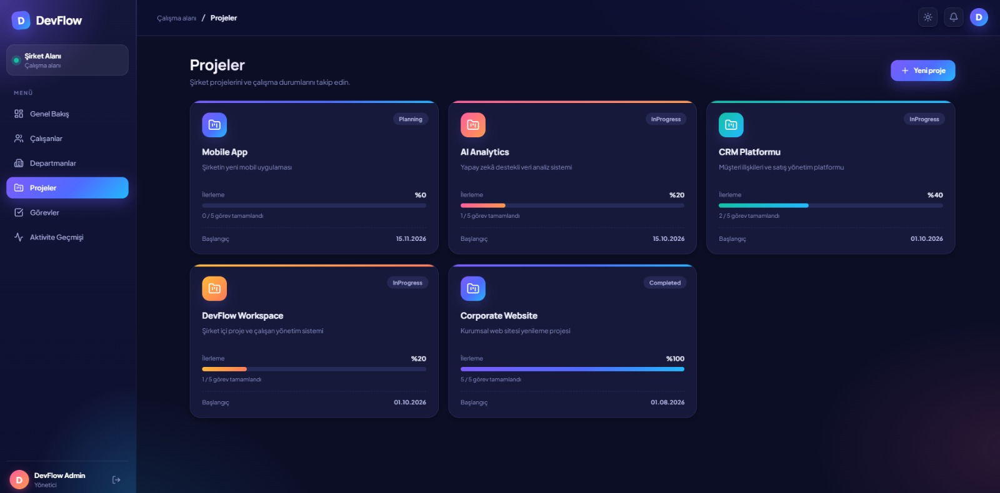
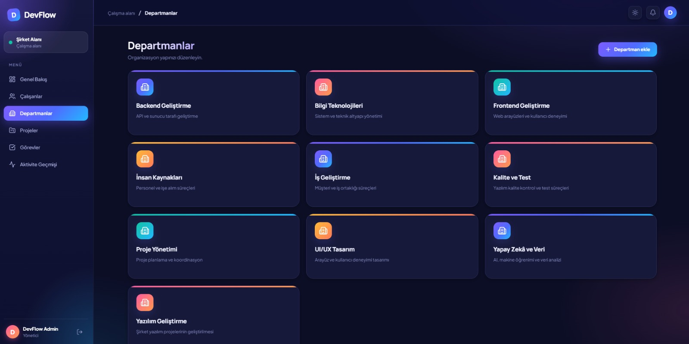
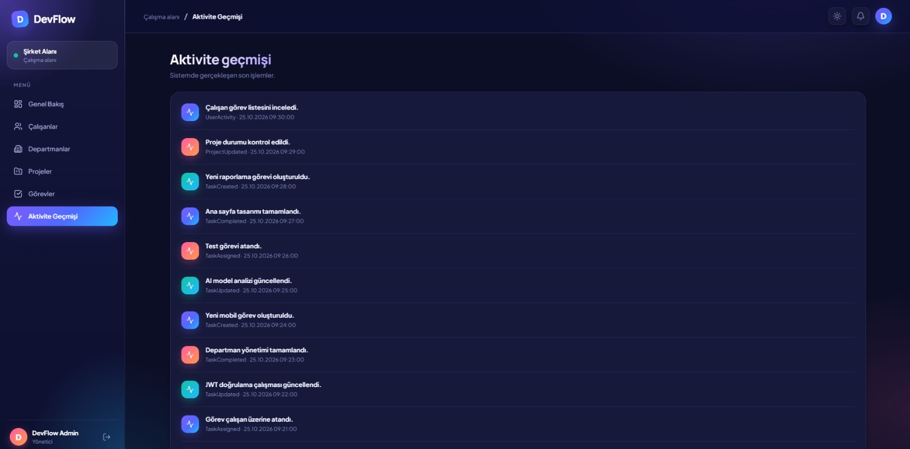

# DevFlow MVP

**DevFlow**, şirket içi çalışan, departman, proje ve görev süreçlerini tek bir platform üzerinden yönetmek için geliştirilmiş web tabanlı bir proje yönetim uygulamasıdır.

Yönetici, departman yöneticisi ve çalışan rollerine göre farklı yetkiler ve arayüzler sunan bu proje, modern web teknolojileri kullanılarak geliştirilmiş bir MVP (Minimum Viable Product) çalışmasıdır.

<p align="center">
  
</p>

## Özellikler

- Rol bazlı kullanıcı yönetimi (Admin, Department Manager, Employee)
- JWT tabanlı kimlik doğrulama
- ASP.NET Core Identity ile kullanıcı yönetimi
- Çalışan oluşturma ve yönetimi
- Departman oluşturma ve listeleme
- Proje oluşturma ve yönetimi
- Görev oluşturma ve çalışanlara atama
- Görev durumlarını güncelleme
- Kanban görev yönetimi
- Görev yorumları
- Kullanıcı aktivite kayıtları
- Yönetici ve çalışanlara özel paneller
- Grafik ve veri görselleştirme

## Uygulama Ekranları

DevFlow, yönetici ve çalışan kullanıcıları için farklı ekranlar sunar.

### Yönetici Paneli

#### Genel Bakış

Toplam çalışan, aktif proje, toplam görev ve tamamlanma oranı gibi özet bilgilerin yanı sıra durum dağılımı, projelere göre görevler ve yaklaşan teslimler grafikleri yer alır.


#### Kanban Görev Yönetimi

Görev kartları sürüklenip bırakılarak veya açılır menüden durum değiştirilerek (Yapılacak, Devam ediyor, Kontrolde, Tamamlandı) güncellenebilir.


#### Projeler

Projelerin durumu, ilerleme yüzdesi ve tamamlanan görev sayısı kartlar üzerinden takip edilir.



#### Çalışanlar ve Departmanlar

<table>
  <tr>
    <td width="50%">
      
      <p align="center"><b>Çalışanlar</b></p>
    </td>
    <td width="50%">
      
      <p align="center"><b>Departmanlar</b></p>
    </td>
  </tr>
</table>

#### Aktivite Geçmişi

Sistemde gerçekleşen son işlemler (görev oluşturma, atama, güncelleme, tamamlama vb.) zaman bilgisiyle listelenir.



### Çalışan Paneli

Çalışanlar yalnızca kendilerine atanan görevleri ve ilgili projeleri görür.


<table>
  <tr>
    <td width="50%">
      
      <p align="center"><b>Görevlerim</b></p>
    </td>
    <td width="50%">
      
      <p align="center"><b>Projeler</b></p>
    </td>
  </tr>
</table>

## Kullanılan Teknolojiler

| Alan | Teknoloji |
|---|---|
| Backend | .NET 8, ASP.NET Core Web API |
| Programlama Dili | C# |
| ORM | Entity Framework Core |
| Veritabanı | Microsoft SQL Server |
| Kimlik Doğrulama | JWT, ASP.NET Core Identity |
| Frontend | React |
| Geliştirme Sunucusu | Vite |
| Grafik ve Veri Görselleştirme | Recharts |
| Stil | CSS |
| API Dokümantasyonu | Swagger |

## Gereksinimler

Projeyi çalıştırmadan önce aşağıdaki araçların kurulu olması gerekir:

- [.NET 8 SDK](https://dotnet.microsoft.com/download/dotnet/8.0)
- [Node.js 20 veya üzeri](https://nodejs.org/)
- [Microsoft SQL Server](https://www.microsoft.com/en-us/sql-server/sql-server-downloads)
- [Git](https://git-scm.com/)

## Kurulum

### 1. Projeyi bilgisayarınıza indirin

Terminal veya PowerShell açarak aşağıdaki komutları çalıştırın:

```bash
git clone https://github.com/Umut-Erdon/DevFlow_MVP.git
cd DevFlow_MVP
```

### 2. Veritabanı bağlantısını yapılandırın

`backend/DevFlow.Api/appsettings.json` dosyasını açın.

`ConnectionStrings` bölümündeki `DefaultConnection` değerini kendi SQL Server kurulumunuza göre düzenleyin.

Windows Authentication için örnek bağlantı:

```json
{
  "ConnectionStrings": {
    "DefaultConnection": "Server=localhost;Database=DevFlowDb;Trusted_Connection=True;TrustServerCertificate=True;"
  }
}
```

SQL Server sunucu adınız farklıysa `localhost` yerine kendi sunucu adınızı kullanın.

### 3. Backend kurulumu

Yeni bir terminal açın ve backend klasörüne geçin:

```bash
cd backend/DevFlow.Api
```

Bağımlılıkları yükleyin:

```bash
dotnet restore
```

Entity Framework Core CLI kurulu değilse:

```bash
dotnet tool install --global dotnet-ef --version 8.0.22
```

Veritabanını oluşturun ve mevcut migration işlemlerini uygulayın:

```bash
dotnet ef database update
```

Backend uygulamasını başlatın:

```bash
dotnet run
```

Backend varsayılan olarak aşağıdaki adreste çalışır:

- API: http://localhost:5080
- Swagger: http://localhost:5080/swagger

### 4. Frontend kurulumu

Backend çalışmaya devam ederken yeni bir terminal açın.

Projenin ana klasöründen frontend klasörüne geçin:

```bash
cd frontend
```

Frontend bağımlılıklarını yükleyin:

```bash
npm install
```

Recharts kütüphanesinin kurulu olduğunu kontrol edin:

```bash
npm ls recharts
```

Recharts kurulu değilse yükleyin:

```bash
npm install recharts
```

Frontend uygulamasını başlatın:

```bash
npm run dev
```

Frontend varsayılan olarak aşağıdaki adreste çalışır:

http://localhost:5173

## Demo Hesapları

Uygulama ilk başlatıldığında yönetici hesabı otomatik olarak oluşturulur.

| Rol | E-posta | Şifre |
|---|---|---|
| Admin | admin@devflow.local | DevFlow123! |
| Employee | employee01@devflow.local | DevFlow123! |

Diğer demo çalışan hesapları:

- employee02@devflow.local
- employee03@devflow.local
- employee04@devflow.local
- employee05@devflow.local
- employee06@devflow.local
- employee07@devflow.local
- employee08@devflow.local
- employee09@devflow.local
- employee10@devflow.local

Tüm demo çalışan hesaplarının başlangıç şifresi:

`DevFlow123!`

**Not:** Demo hesapları yalnızca yerel geliştirme ve test amacıyla hazırlanmıştır. Gerçek ortamlarda kullanılmamalıdır.

## Proje Yapısı

```text
DevFlow_MVP/
│
├── backend/
│   └── DevFlow.Api/
│       ├── Controllers/
│       ├── Data/
│       ├── Models/
│       ├── Migrations/
│       ├── Services/
│       ├── appsettings.json
│       └── Program.cs
│
├── frontend/
│   ├── src/
│   ├── public/
│   ├── package.json
│   └── vite.config.js
│
├── docs/
│   └── screenshots/
│
└── README.md
```

## Güvenlik ve Geliştirme Notları

DevFlow, geliştirme ve gösterim amacıyla hazırlanmış bir MVP projesidir.

Canlı ortama alınmadan önce aşağıdaki geliştirmelerin yapılması önerilir:

- Parola değiştirme ve sıfırlama süreçleri
- E-posta doğrulama ve davet sistemi
- API rate limiting
- Birim ve entegrasyon testleri
- Loglama ve hata izleme
- Veritabanı yedekleme
- Güvenlik kontrolleri
- Şirketler arası veri izolasyonunun tüm sorgularda ve yetkilendirme katmanında doğrulanması

`CompanyId` alanı şirket bazlı veri ayrımı için temel oluşturur. Ancak çok kiracılı kullanım için tüm sorguların ve yetkilendirme işlemlerinin şirket kapsamına göre güvenli biçimde kontrol edilmesi gerekir.

## Lisans

Bu proje portföy, eğitim ve geliştirme amacıyla hazırlanmıştır. Kullanım ve dağıtım koşulları için repository lisans bilgilerini inceleyin.
